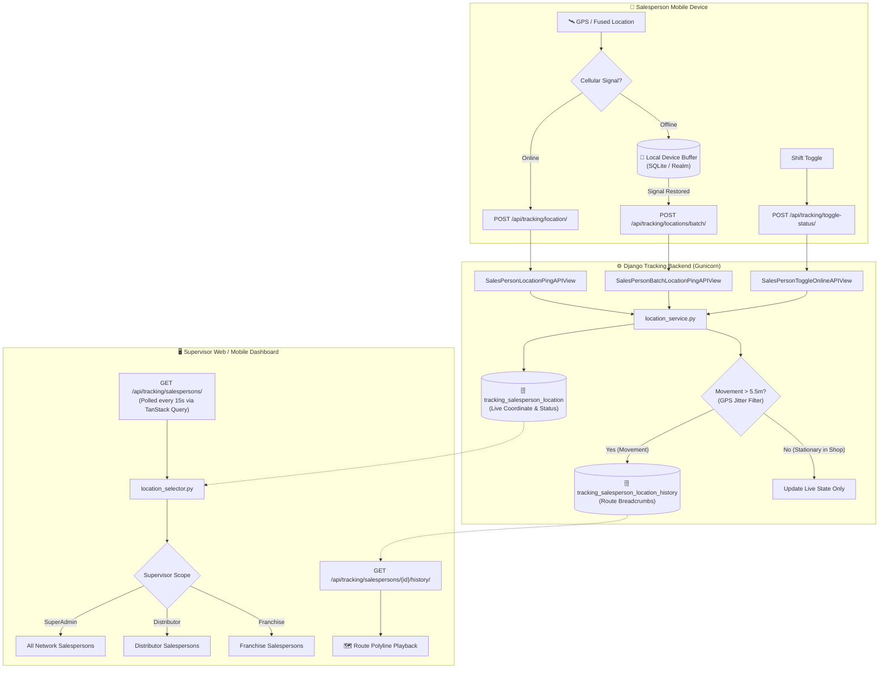
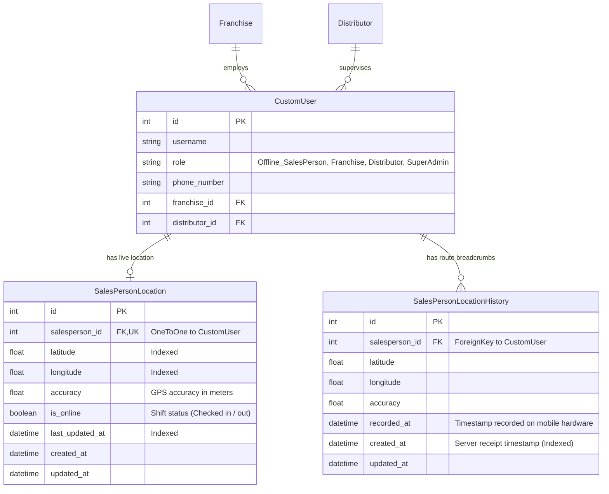
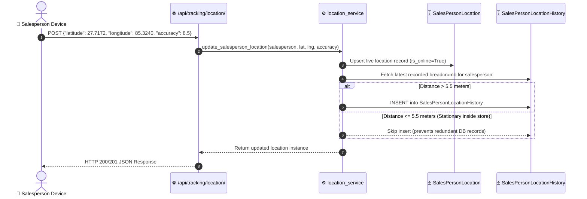
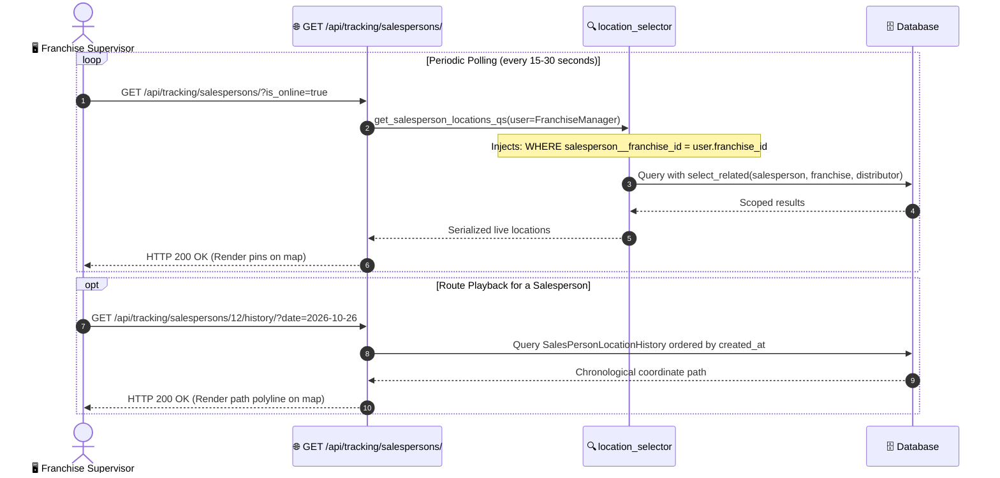

# Offline Salesperson Tracking System Documentation

Comprehensive architecture, data flows, database schemas, and API reference for tracking field salespersons (`Offline_SalesPerson`) across franchises and distributors.

---

## 1. System Overview

The **Tracking System** monitors the real-time position, route history, movement activity, and field availability of offline salespersons physically visiting retail stores, grocery shops, and wholesalers.

### Key Capabilities
- **Lightweight HTTP REST Architecture:** Uses lightweight HTTP POST pings instead of heavy WebSockets, preserving device resources and conforming to Android/iOS background service constraints.
- **GPS Micro-Jitter Suppression:** Filters out stationary GPS fluctuations (< 5.5 meters) so multiple pings sent while a salesperson is inside a shop do not bloat the database.
- **Offline Buffer & Batch Sync:** If a salesperson enters a basement, warehouse, or rural store without cellular reception, the mobile app stores pings in local SQLite and uploads them in a single batch once network connectivity returns.
- **Automatic Heartbeat Timeout (Stale Device Detection):** Solves the dead-phone/no-signal problem. If a salesperson drops offline or their device powers off without clocking out, the system automatically transitions their status to `INACTIVE` after 5 minutes of ping silence, ensuring the supervisor map always reflects accurate field reality.
- **Multi-State Status Tracking:** Distinguishes between `ONLINE` (broadcasting right now), `INACTIVE` (shift started but signal lost/phone off), and `OFFLINE` (shift ended).
- **Organizational Data Isolation:** Strictly scopes live location views to the supervisor’s jurisdiction:
  - `SuperAdmin`: Network-wide visibility across all distributors and franchises.
  - `Distributor`: Only salespersons belonging to their distributor or child franchises.
  - `Franchise`: Only salespersons belonging to their specific franchise.
  - `Offline_SalesPerson`: Strictly isolated to their own location.

---

## 2. Architecture & Data Flow Diagram



---

## 3. Database Schema (ERD)



---

## 4. Sequence Diagrams

### 4.1 In-Field Real-Time Ping with Micro-Jitter Suppression



---

### 4.2 Offline Store Visit & Reconnection Batch Sync

```mermaid
sequenceDiagram
    autonumber
    actor SP as 📱 Salesperson Device
    participant LocalDB as 💾 Local Phone SQLite
    participant API as 🌐 /api/tracking/locations/batch/
    participant Svc as ⚙️ location_service
    participant HistDB as 🗄️ SalesPersonLocationHistory (Bulk)
    participant LiveDB as 🗄️ SalesPersonLocation

    Note over SP,LocalDB: Signal lost inside retailer's basement
    SP->>LocalDB: Store Ping #1 (10:15 AM, Lat 27.7150, Lng 85.3200)
    SP->>LocalDB: Store Ping #2 (10:20 AM, Lat 27.7165, Lng 85.3225)
    SP->>LocalDB: Store Ping #3 (10:25 AM, Lat 27.7180, Lng 85.3250)

    Note over SP,API: Device exits shop; cellular signal reconnected
    SP->>API: POST /api/tracking/locations/batch/<br/>{"pings": [Ping #1, Ping #2, Ping #3]}
    API->>Svc: bulk_record_offline_pings(user, pings)
    Svc->>HistDB: bulk_create([History #1, History #2, History #3])
    Svc->>LiveDB: Update live location to Ping #3 coordinates
    Svc-->>API: Return synced_count = 3
    API-->>SP: HTTP 201 Created {"status": "success", "synced_count": 3}
    SP->>LocalDB: Clear uploaded offline buffer
```

---

### 4.3 Supervisor Live Map Monitoring & Route Playback



---

## 5. API Reference

All tracking routes are registered under the `/api/tracking/` base prefix.

| Method | Endpoint | Description | Permission |
| :--- | :--- | :--- | :--- |
| `POST` | `/api/tracking/location/` | Submit current live GPS coordinate ping | `Offline_SalesPerson` |
| `POST` | `/api/tracking/locations/batch/` | Upload buffered GPS coordinates saved while offline | `Offline_SalesPerson` |
| `POST` | `/api/tracking/toggle-status/` | Toggle work shift availability (`is_online`) | `Offline_SalesPerson` |
| `GET` | `/api/tracking/me/` | Salesperson views their own active status & position | `Offline_SalesPerson` |
| `GET` | `/api/tracking/salespersons/` | List all live salespersons with filters | `SuperAdmin`, `Distributor`, `Franchise` |
| `GET` | `/api/tracking/salespersons/<id>/` | View live location details for a single salesperson | `SuperAdmin`, `Distributor`, `Franchise` |
| `GET` | `/api/tracking/salespersons/<id>/history/` | Retrieve route playback breadcrumbs for a salesperson | Supervisor or Self |
| `GET` | `/api/tracking/history/` | Route breadcrumbs filtered by query parameters | Supervisor or Self |

---

### 5.1 Endpoint Details & JSON Payloads

#### 1. Live Location Ping
- **Route:** `POST /api/tracking/location/`
- **Headers:** `Authorization: Bearer <JWT_ACCESS_TOKEN>`
- **Request Body:**
```json
{
  "latitude": 27.71724,
  "longitude": 85.32402,
  "accuracy": 4.5,
  "recorded_at": "2026-10-26T14:30:00Z"
}
```
- **Response (HTTP 200 OK / 201 Created):**
```json
{
  "id": 1,
  "salesperson_id": 12,
  "username": "ramesh_sales",
  "full_name": "Ramesh Sharma",
  "phone_number": "9841234567",
  "role": "Offline_SalesPerson",
  "franchise_id": 3,
  "franchise_name": "Kathmandu North Franchise",
  "latitude": 27.71724,
  "longitude": 85.32402,
  "accuracy": 4.5,
  "is_online": true,
  "is_active_now": true,
  "tracking_status": "ONLINE",
  "seconds_since_last_ping": 12,
  "last_updated_at": "2026-10-26T14:30:00.123456+05:45"
}
```

---

#### 2. Offline Batch Upload
- **Route:** `POST /api/tracking/locations/batch/`
- **Request Body:**
```json
{
  "pings": [
    {
      "latitude": 27.71500,
      "longitude": 85.32000,
      "accuracy": 5.0,
      "recorded_at": "2026-10-26T14:15:00Z"
    },
    {
      "latitude": 27.71650,
      "longitude": 85.32250,
      "accuracy": 4.0,
      "recorded_at": "2026-10-26T14:20:00Z"
    },
    {
      "latitude": 27.71800,
      "longitude": 85.32500,
      "accuracy": 3.8,
      "recorded_at": "2026-10-26T14:25:00Z"
    }
  ]
}
```
- **Response (HTTP 201 Created):**
```json
{
  "status": "success",
  "message": "Successfully synced 3 offline location pings.",
  "synced_count": 3
}
```

---

#### 3. Toggle Online Availability
- **Route:** `POST /api/tracking/toggle-status/`
- **Request Body:**
```json
{
  "is_online": false
}
```
- **Response (HTTP 200 OK):**
```json
{
  "id": 1,
  "salesperson_id": 12,
  "username": "ramesh_sales",
  "full_name": "Ramesh Sharma",
  "phone_number": "9841234567",
  "role": "Offline_SalesPerson",
  "franchise_id": 3,
  "franchise_name": "Kathmandu North Franchise",
  "latitude": 27.71800,
  "longitude": 85.32500,
  "accuracy": 3.8,
  "is_online": false,
  "last_updated_at": "2026-10-26T18:00:00+05:45"
}
```

---

#### 4. Supervisor Live Map Query
- **Route:** `GET /api/tracking/salespersons/?is_online=true&search=Ramesh`
- **Query Parameters:**
  - `is_online` (bool): `true` or `false`
  - `franchise` (int): Franchise ID (for SuperAdmin/Distributor)
  - `distributor` (int): Distributor ID (for SuperAdmin)
  - `search` (str): Search by name, username, or phone number
- **Response (HTTP 200 OK):**
```json
[
  {
    "id": 1,
    "salesperson_id": 12,
    "username": "ramesh_sales",
    "full_name": "Ramesh Sharma",
    "phone_number": "9841234567",
    "role": "Offline_SalesPerson",
    "franchise_id": 3,
    "franchise_name": "Kathmandu North Franchise",
    "latitude": 27.71724,
    "longitude": 85.32402,
    "accuracy": 4.5,
    "is_online": true,
    "last_updated_at": "2026-10-26T14:30:00+05:45"
  }
]
```

---

#### 5. Route Path / Historical Breadcrumbs
- **Route:** `GET /api/tracking/salespersons/12/history/?date=2026-10-26`
- **Query Parameters:**
  - `date` (YYYY-MM-DD): Filter breadcrumbs for a specific date
  - `start_datetime` (ISO 8601): Filter from timestamp
  - `end_datetime` (ISO 8601): Filter to timestamp
- **Response (HTTP 200 OK):**
```json
[
  {
    "id": 105,
    "salesperson_id": 12,
    "salesperson_name": "Ramesh Sharma",
    "latitude": 27.71800,
    "longitude": 85.32500,
    "accuracy": 3.8,
    "recorded_at": "2026-10-26T14:25:00Z",
    "created_at": "2026-10-26T14:25:01Z"
  },
  {
    "id": 104,
    "salesperson_id": 12,
    "salesperson_name": "Ramesh Sharma",
    "latitude": 27.71650,
    "longitude": 85.32250,
    "accuracy": 4.0,
    "recorded_at": "2026-10-26T14:20:00Z",
    "created_at": "2026-10-26T14:20:01Z"
  },
  {
    "id": 103,
    "salesperson_id": 12,
    "salesperson_name": "Ramesh Sharma",
    "latitude": 27.71500,
    "longitude": 85.32000,
    "accuracy": 5.0,
    "recorded_at": "2026-10-26T14:15:00Z",
    "created_at": "2026-10-26T14:15:01Z"
  }
]
```

---

## 6. Frontend & Mobile Integration Guidelines

### Mobile Client (Android / iOS)
1. **Periodic Background Service:**
   - Configure a native location manager (`FusedLocationProviderClient` on Android, `CLLocationManager` on iOS) to request location every 30 to 60 seconds with balanced power accuracy.
2. **Connectivity Handling:**
   - On each location update, check network status using a connectivity listener.
   - If online: send `POST /api/tracking/location/`.
   - If offline: store the dictionary `{"latitude", "longitude", "accuracy", "recorded_at"}` into local SQLite storage.
   - When network connectivity returns, flush the buffer via `POST /api/tracking/locations/batch/` and purge local rows once a 201 response is received.

### Web Dashboard (Next.js / React)
1. **Polling Live Locations:**
   - Use TanStack Query with `refetchInterval`:
   ```typescript
   const { data: salespersons } = useQuery({
     queryKey: ['salespersons-locations'],
     queryFn: () => api.get('/api/tracking/salespersons/'),
     refetchInterval: 15000, // Refresh every 15 seconds
   });
   ```
2. **Map Markers:**
   - Render Google Maps, Leaflet, or Mapbox markers for each salesperson.
   - Show green pins for `is_online === true`, grey pins for `is_online === false`.
   - Click marker to display name, phone, and last update time.
3. **Route Playback Polyline:**
   - When inspecting a salesperson's route, fetch `GET /api/tracking/salespersons/{id}/history/?date={selectedDate}`.
   - Map coordinates into polyline path points `[[lat, lng], [lat, lng], ...]` to visualize the travel path across customer stores.
